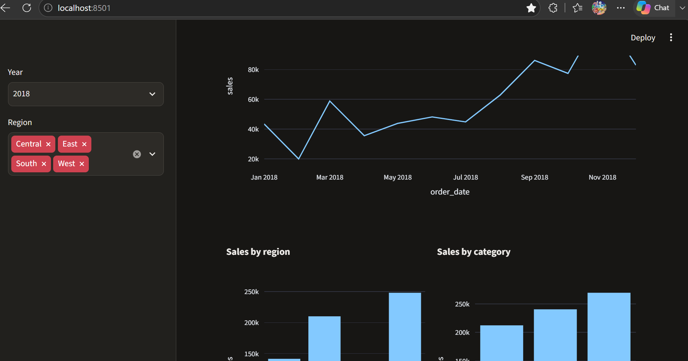

# Retail Sales Analysis

## Goal
Clean and explore US retail order data (2015–2018) to understand sales trends.

## Data
`train.csv`: 9,800 order lines. It has no profit, cost or quantity fields.

## Cleaning
- Converted order and ship dates to real dates
- Removed extra spaces in product names
- Restored leading zeros in postal codes
- Filled 11 missing Burlington, Vermont postal codes with 05401 (assumption)
- Flagged, but kept, a possible duplicate, product ID conflicts and high sales

## Key findings
- 2018 sales were $722,052, up 20.3% on 2017
- Sales are usually higher from September to December
- West led all regions in 2018; Technology led all categories
- The typical (median) order line is $54, while the average is $231

## How to run
1. `pip install pandas seaborn matplotlib jupyterlab ipykernel`
2. `python clean_train.py train.csv`
3. Open `eda.ipynb` and run all cells

## How to run
python -m streamlit run dashboard/app.py (after installing streamlit and plotly).

## Dashboard


Run it with:

```
pip install streamlit plotly
python -m streamlit run dashboard/app.py
```